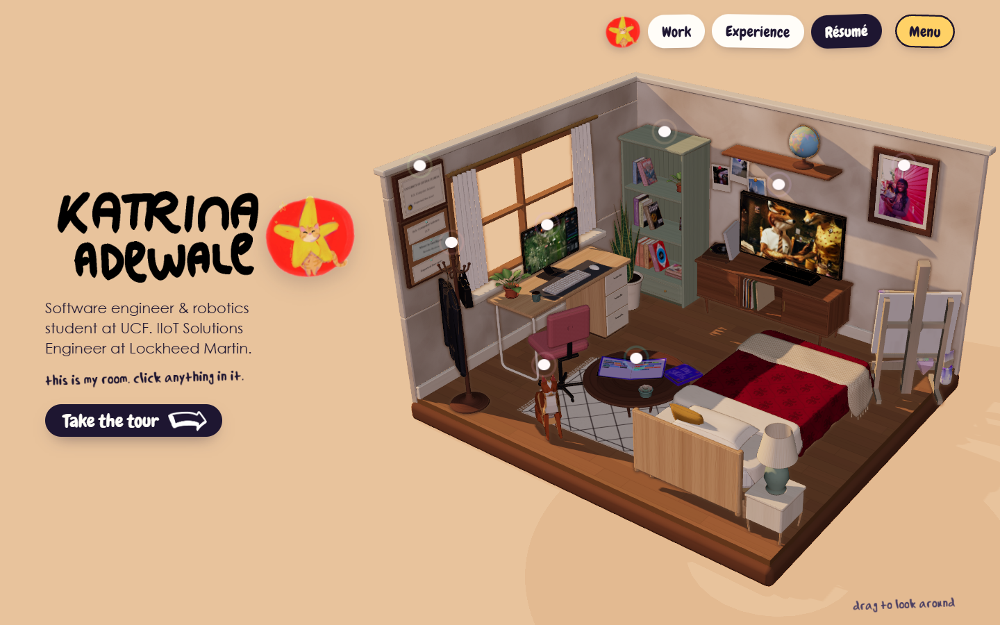
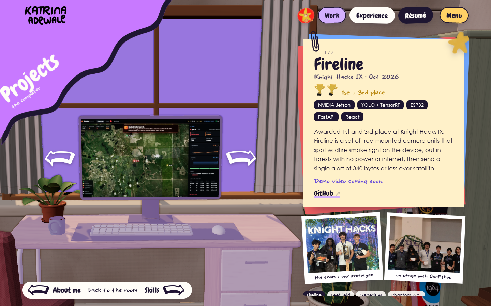
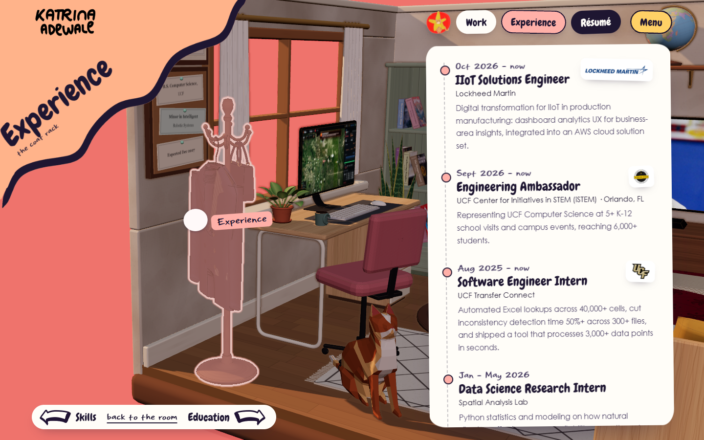
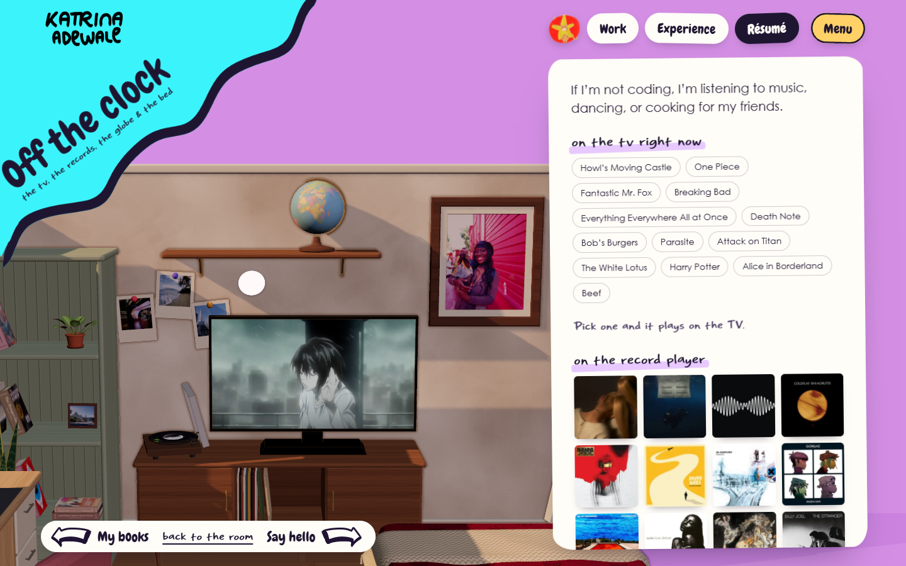
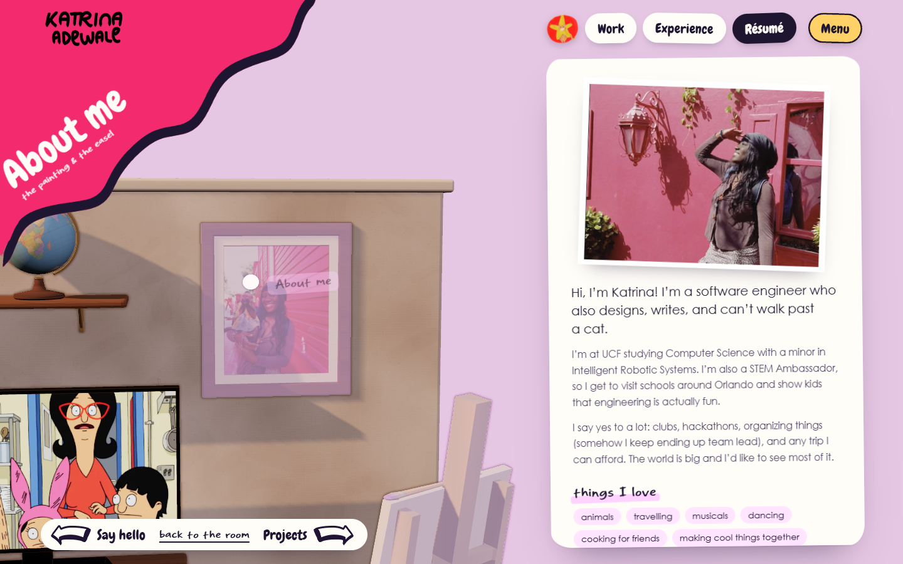
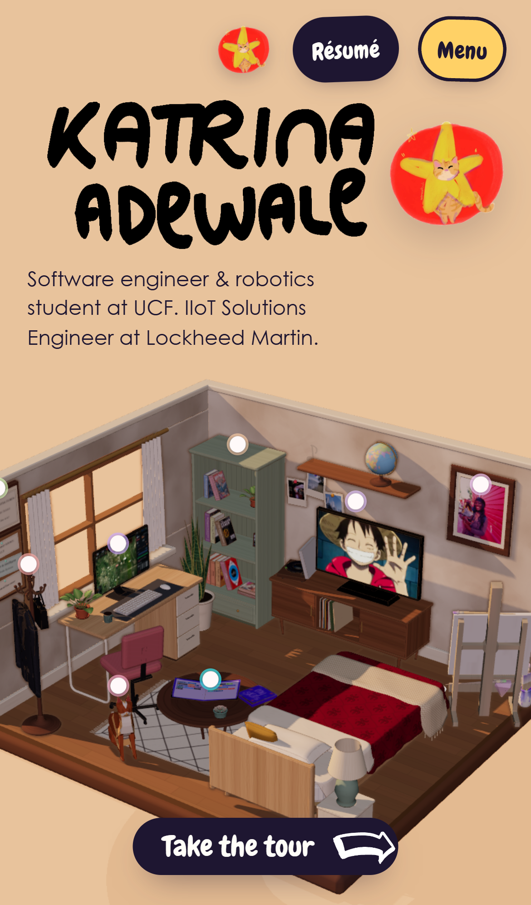
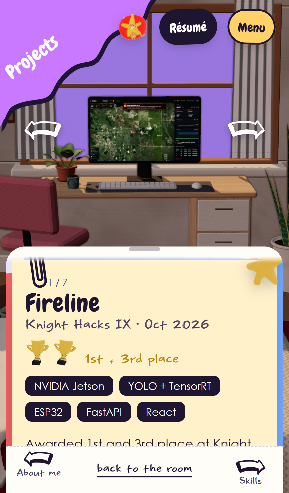

# Portfolio 3.0 · 3D

**My portfolio, third version. This time it's my bedroom, and you can walk around it.**

Every object in the room opens part of my story. Click the computer for my projects, the coat rack for my experience, the bookshelf for what I'm reading, the TV and the records for what I do off the clock. The camera flies over, a torn sheet of paper slides in, and the section reads like a note I left on the desk.

**🌐 Website: [katrinaadewale.dev](https://katrinaadewale.dev/)**

<p>
  
  
  
  
  
  <br>
  
  
  
  
</p>



## Why a room

For the third version I wanted something a recruiter would actually remember, not another page of cards. The room started as a sketch on graph paper, and the interface is drawn by hand: the name lettering, the cursor, the arrows, the star cat and the torn paper are all my own drawings.

It still has to work for someone skimming in under a minute, so the résumé is always one click away in the top bar, and every section can also be reached from the menu without touching the 3D scene.

## What's in the room

| Click | Opens |
|---|---|
| The painting & the easel | About me |
| The computer | Projects (the demo plays on the monitor) |
| The book on the coffee table | Skills |
| The coat rack | Experience |
| The wall by the window | Education |
| The bookshelf | My books |
| The TV, the records, the globe & the bed | Off the clock |
| The cat | Say hello (click it again for a meow) |

<p>
  
  
</p>
<p>
  
  
</p>

On a phone, the room sits above a sheet you can pull down to see more of it.

<p>
  
  
</p>

## How it's built

- **No framework, no build step.** Plain ES modules and Three.js (r180, vendored), served as static files from `port-3.0-source/port-3.0/dist`.
- **The room shell** (walls, window, floor) was modelled in Blender (`source/katrina-room.blend`). Most of the furniture is built in code: the bed and bedding, desk, chair, monitor, bookcase and books, sideboard, coat rack, blazer, rug, plants and globe. That way each piece shares the same proportions, materials and edge softening.
- **The books are my real shelf.** Each spine takes its colour from the actual cover and carries the real title and author.
- **Motion and lighting** follow Orlando time: the sun through the window changes through the day, and the bedside lamp switches on after dark.
- **Tested at desktop and phone sizes,** with a script that catches furniture clipping into walls or floating above the floor.
- **Locked down for a static site:** a Content Security Policy, no third-party scripts, and nothing secret in the client.

## Run it

```
cd port-3.0-source/port-3.0
npm install
npm start
```

Then open http://localhost:5173. Pushing to `main` publishes the site to katrinaadewale.dev through GitHub Actions.

## Credits

- Furniture kit pieces: [Kenney Furniture Kit](https://kenney.nl), CC0
- Cat, easel and slippers models: via [Poly Pizza](https://poly.pizza) (see `dist/assets/models/CREDITS.txt`)
- Globe borders: [BlankMap-World-Equirectangular](https://commons.wikimedia.org/wiki/File:BlankMap-World-Equirectangular.svg), public domain
- Meow: yomecerlm3 on [Pixabay](https://pixabay.com)
- Placeholder project photos: [Unsplash](https://unsplash.com) (see `dist/assets/photos/CREDITS.txt`)
- Everything hand-drawn, plus the photos of me: mine
